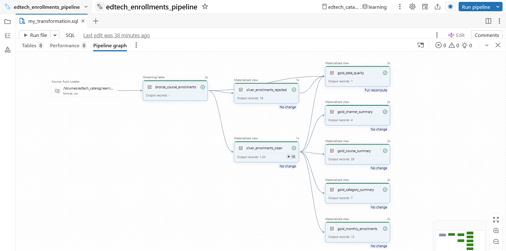

# 🎓 Online Learning Enrollment Analytics Platform

An end-to-end data engineering project built on **Databricks** using **Lakeflow Spark Declarative Pipelines (SQL)** and the **Medallion Architecture** (Bronze → Silver → Gold), with an **AI/BI dashboard** on top.

A raw course enrollments CSV with real-world data problems is cleaned, validated, summarised and visualised, and every row is accounted for with a reconciliation check.

---

## 📌 Business Problem

An online learning platform exports every course enrollment to a CSV file. The file has common data quality problems:

- Extra spaces and inconsistent capital letters in category, level, city and channel
- Messy learner emails (capital letters, spaces), so one learner looks like two people
- Blank category, city, learner ID and price paid
- Duplicate enrollments that inflate enrollments and revenue
- Progress values outside 0 to 100 and negative prices

Managers need reliable numbers on enrollments, revenue, completion, learners and channels. This project builds a repeatable pipeline that produces them.

---

## 🏗️ Architecture

```
course_enrollments_raw.csv (Unity Catalog Volume)
            │
            ▼
   🥉 BRONZE  → bronze_course_enrollments        (raw data + file name + load time)
            │
            ▼
   🥈 SILVER  → silver_enrollments_clean          (deduplicated, cleaned, learner_status added)
              → silver_enrollments_rejected       (invalid rows saved with a reason)
            │
            ▼
   🥇 GOLD    → gold_monthly_enrollments
              → gold_category_summary
              → gold_course_summary
              → gold_channel_summary
              → gold_data_quality                 (problem counts + reconciliation)
            │
            ▼
   📊 Databricks AI/BI Dashboard (3 pages)
```

### Pipeline Graph



---

## 🛠️ Tech Stack

| Area | Tool |
|---|---|
| Platform | Databricks |
| Pipeline | Lakeflow Spark Declarative Pipelines (SQL) |
| Storage | Unity Catalog Volume |
| Architecture | Medallion (Bronze, Silver, Gold) |
| Dashboard | Databricks AI/BI Dashboard |
| Language | SQL |

---

## 🧹 Data Cleaning Rules

| Problem | Fix | SQL used |
|---|---|---|
| Duplicate enrollments | Keep one copy per row | `SELECT DISTINCT` |
| Extra spaces / mixed case | Trim and use Title Case | `INITCAP(TRIM(col))` |
| Messy emails | Trim and use lower case | `LOWER(TRIM(learner_email))` |
| Blank category or city | Replace with "Unknown" | `COALESCE(NULLIF(...), 'Unknown')` |
| Blank price paid | list_price − discount_amount | `COALESCE(price_paid, list_price - discount_amount)` |
| Blank rating or learner ID | Keep as NULL (AVG skips NULLs) | No change |
| Progress outside 0 to 100 | Drop from clean table, save in rejected table | `EXPECT ... ON VIOLATION DROP ROW` |
| Negative price paid | Drop from clean table, save in rejected table | `EXPECT ... ON VIOLATION DROP ROW` |

**New column:** `learner_status` = Completed (progress 100), In Progress (1 to 99), Not Started (0).

---

## ✅ Data Quality Results

| Check | Result |
|---|---|
| Bronze rows | 1,283 |
| Duplicate rows removed | 23 |
| Rejected rows (invalid progress 11 + negative price 8) | 19 |
| **Clean rows** | **1,241** |
| Missing category / city / price paid | 12 / 10 / 15 |
| Learners before email fix | 602 |
| Learners after email fix | 555 |
| **Learners double-counted because of messy emails** | **47** |

**Reconciliation:** `1,283 (bronze) = 1,241 (clean) + 19 (rejected) + 23 (duplicates)` ✅ **Passed**

Learner status split: Completed 349 | In Progress 651 | Not Started 241 (total 1,241).

---

## 📊 Dashboard

### Page 1: Overview


### Page 2: Courses & Channels


### Page 3: Data Quality


---

## 📁 Repository Structure

```
online-learning-enrollment-analytics/
├── README.md
├── sql/
│   ├── 01_bronze.sql
│   ├── 02_silver.sql
│   └── 03_gold.sql
├── data/
│   └── course_enrollments_raw.csv
└── screenshots/
    ├── pipeline_graph.png
    ├── dashboard_overview.png
    ├── dashboard_courses.png
    └── dashboard_quality.png
```

---

## 🚀 How to Run

1. In Databricks, create the storage:
   ```sql
   CREATE CATALOG IF NOT EXISTS edtech_catalog;
   CREATE SCHEMA  IF NOT EXISTS edtech_catalog.learning;
   CREATE VOLUME  IF NOT EXISTS edtech_catalog.learning.raw_files;
   ```
2. Upload `data/course_enrollments_raw.csv` to the volume `edtech_catalog.learning.raw_files`.
3. Create a new **ETL pipeline** with default catalog `edtech_catalog` and default schema `learning`.
4. Add the three SQL files from the `sql/` folder (`01_bronze.sql`, `02_silver.sql`, `03_gold.sql`)